# План: собственная школьная ОС на Linux, максимально близкая к Windows

Автор проекта: Латипов С.А. Статус документа: **план**, кода ОС пока нет; лаунчер SchoolShield (Windows и Linux Mint) станет её оболочкой.
Дата: 2 ноября 2026. Это инженерный план, а не юридическое заключение: нормативные ссылки сверяйте с действующими редакциями, а по персональным данным привлекайте ответственного за их обработку или юриста.

## 1. Что строим и зачем

**Школьная ОС «SchoolShield OS»**: свободный дистрибутив на базе Linux, на котором:

* привычно тем, кто работал в Windows: панель задач внизу, меню «Пуск», трей, проводник, `Win+E`, `Win+D`, `Alt+Tab`, `Win+L`, привычные шрифты (метрически совместимые) и раскладка настроек;
* запускаются **программы Linux и Windows** (Windows-программы через Wine/Proton/Bottles, а то, что не заводится, через виртуальную машину);
* три готовых профиля: **Ученик** (лаунчер вместо рабочего стола, как в Windows-версии SchoolShield), **Учитель** (обычный рабочий стол, только фильтр 18+, Центр учителя), **Администратор** (полный рабочий стол и инструменты);
* лицензии свободные (GPL, LGPL, MIT, BSD, Apache): любая школа может установить, изучить и изменить систему без платежей;
* безопасность и защита персональных данных (ПД) заложены в архитектуру, а не прикручены сверху.

Причины: поддержка Windows 10 закончилась 14.10.2025, а школьные компьютеры стареют быстрее, чем обновляется парк; свободная ОС снимает лицензионные расходы и даёт контроль над данными.

**Чего не делаем (по крайней мере сейчас):** собственное ядро, собственный менеджер пакетов, форк Wine, клон интерфейса Windows с чужой графикой (юридический риск, см. раздел 6), сертификацию во ФСТЭК/ФСБ «с нуля» (см. раздел 7).

## 2. Главное решение: на чём строить

| Вариант | Плюсы | Минусы | Вывод |
|---------|-------|--------|-------|
| **Debian 13 «trixie» (стабильный)** + `live-build` | Полностью свободная политика пакетов, долгая поддержка, предсказуемость, огромный репозиторий, Calamares-установщик, есть `Debian Edu` как готовый школьный образец | Пакеты старее, чем у Ubuntu; нужно самим собирать образ | **Основа первой версии** |
| **Debian Edu (Skolelinux)** как основа | Готовое школьное решение: сервер LDAP/Kerberos/Samba, профили, LTSP для бездисковых рабочих мест, русский интерфейс | Свой внешний вид и устройство сети: придётся подстраиваться | Вариант Б: взять как референс или как базу сервера |
| **Linux Mint 22 / LMDE 7** | Самый Windows-подобный готовый рабочий стол (Cinnamon), хорошо знаком учителям | База Ubuntu (Mint) или Debian (LMDE): наши отличия придётся накладывать поверх, торговые марки Mint | Текущая цель редакции «Учитель»; для ОС брать идеи и настройки |
| Ubuntu LTS (+ Cubic) | Свежие пакеты, большое сообщество | Snap по умолчанию, торговая марка, политика Canonical | Не основа |
| Fedora Atomic / bootc | Образная (неизменяемая) модель, откат, современная безопасность | Другое семейство (RPM), SELinux, меньше школьного опыта | План на фазу 3: перенять подход (ostree/bootc) |
| Альт Образование / Astra / РЕД ОС | Российские дистрибутивы, у части есть сертификаты ФСТЭК | Лицензионные условия у каждого свои, нельзя просто «форкнуть» | Использовать там, где нужна сертификация (раздел 7) |
| ReactOS | Цель: двоичная совместимость с Windows (NT), лицензия GPL | Стадия альфа, нестабильна, драйверов мало | Не для школ. Wine решает ту же задачу лучше |

**Решение:** база **Debian 13 «trixie»**, образ собирается `live-build`, установщик **Calamares** (GPL-3). Стабильный Debian — это свободный набор по умолчанию; «несвободные» прошивки (Wi-Fi, часть видеокарт) выносятся в отдельный образ «с прошивками».

Рабочий стол для профиля «Учитель» и «Администратор» выбирается по итогам пилота: **Cinnamon** (проще, ближе всего к Windows 7/10, лёгкий) или **KDE Plasma 6** (гибче, ближе к Windows 11, но тяжелее). Предварительно: Cinnamon для старых ПК, Plasma для новых. Профиль «Ученик» не использует рабочий стол вообще (раздел 4).

## 3. Слои системы

```mermaid
flowchart TB
  subgraph HW[Оборудование и загрузка]
    UEFI[UEFI Secure Boot + TPM2] --> BOOT[shim + GRUB / UKI, подписанные]
  end
  subgraph BASE[Базовая система Debian 13]
    KERNEL[Ядро Linux с усилениями] --> SVC[systemd, AppArmor, nftables, USBGuard, auditd]
  end
  subgraph SS[Службы SchoolShield]
    FILTER[filterd: DNS, политики браузеров, hosts]
    GUARD[guard: окна, ИИ-фильтр экрана]
    UPD[updater: подписанные обновления]
    AGENT[agent: журнал, инвентарь, команды администратора]
  end
  subgraph SESS[Сеансы]
    STUDENT[Ученик: kiosk-оболочка, сброс при выходе]
    TEACHER[Учитель: Cinnamon или Plasma + Центр учителя]
    ADMIN[Администратор: полный рабочий стол]
  end
  subgraph APPS[Программы]
    NATIVE[Нативные и Flatpak] --- WINE[Wine, Proton, Bottles] --- VM[Windows в виртуальной машине KVM]
  end
  subgraph MGMT[Школьный сервер]
    IDM[FreeIPA или Samba AD] --- MIRROR[Зеркало apt и Flatpak, подписанное] --- ANS[Ansible] --- MON[Wazuh, GLPI, Veyon]
  end
  HW --> BASE --> SS --> SESS --> APPS
  MGMT -. управление и обновления .-> SS
```

Принцип: всё, что можно, делается **готовыми свободными компонентами**; наш код — только склейка, интерфейс и школьная логика (фильтр 18+, профили, обновления, журнал).

## 4. Windows-подобный интерфейс и три профиля

### 4.1. Ученик (киоск)

* Сеанс из одного приложения: лаунчер SchoolShield на **WebKitGTK** внутри Wayland-киоска **cage** (MIT) или labwc (GPL-2). Никакого панели, рабочего стола, терминала.
* Те же функции, что в Windows-версии: разделы программ, документы, файлы, встроенный браузер, расписание звонков, громкость, Wi-Fi.
* **Сброс при выходе**: домашний каталог ученика на `tmpfs`/OverlayFS, постоянные файлы только на школьном сервере (Samba/NFS/Nextcloud). Ученик не может «сломать» компьютер: перезагрузка возвращает чистое состояние.
* Установка программ, запуск из `/home`, `/tmp`, с флешки запрещены: `noexec` на пользовательских разделах, AppArmor-профили, `USBGuard` (GPL-2).
* Код администратора и комбинация, открывающие терминал, переносятся из Windows-версии (удержание комбинации, 7 нажатий на часы).

### 4.2. Учитель

* Обычный рабочий стол (Cinnamon/Plasma) с раскладкой «как в Windows»: панель внизу, меню слева, трей справа, значки программ, быстрые клавиши Windows.
* **Центр учителя** (HTML-интерфейс, уже существует для Linux Mint) как главное окно: программы по разделам, документы, файлы, Wi-Fi, звук, питание.
* Ограничение одно: материалы 18+ (DNS-фильтр, политики браузеров, `/etc/hosts`, охрана окон, необязательный ИИ-фильтр экрана). Установка программ и всё остальное свободны.

### 4.3. Администратор

* Полный рабочий стол, `sudo`, Cockpit (LGPL) для веб-управления, набор инструментов из `docs/SYSADMIN-USB.md`.
* Управление флотом: Ansible-роли для установки профилей, политик и обновлений.

### 4.4. «Как в Windows», но без копирования

| Что привычно | Как делаем | Лицензия / заметка |
|--------------|-----------|--------------------|
| Меню «Пуск», панель задач, трей | Cinnamon (меню Mint) или KDE Kickoff; раскладка и закрепления в профиле | GPL/LGPL |
| `Win+E`, `Win+D`, `Win+L`, `Win+R`, `Ctrl+Shift+Esc` | Настройки сочетаний клавиш в профиле: Файлы, показать рабочий стол, блокировка, «Выполнить» (KRunner/Albert), системный монитор | свободно |
| Шрифты Arial, Times New Roman, Calibri, Cambria | **Liberation** (метрически совместимы с Arial/Times/Courier) и **Carlito/Caladea** (с Calibri/Cambria), лицензия SIL OFL. Документы выглядят так же, вёрстка не «плывёт» | OFL |
| Шрифты Microsoft | Не включаем в образ (лицензия Microsoft). Администратор может поставить `ttf-mscorefonts-installer` на свою ответственность | EULA Microsoft |
| Значки и темы | Свободные наборы (Papirus и т. п.) в Windows-подобной раскладке; **не** используем логотипы, значки и звуки Microsoft | проверять лицензию каждой темы: GPL/LGPL/CC-BY-SA |
| Параметры, Панель управления | Единое окно настроек профиля: сеть, звук, экран, принтеры, язык | наше |
| Принтеры | CUPS, драйверы по моделям в образе; проверка парка принтеров в фазе 0 | GPL/Apache |
| Office | LibreOffice (MPL-2), ONLYOFFICE (AGPL), «МойОфис» (проприетарный, по желанию школы) | см. 5 |

## 5. Программы Windows

### 5.1. Слои совместимости (от простого к сложному)

1. **Нативная замена** (лучше всего): LibreOffice вместо Office, GIMP вместо Photoshop, Blender, FreeCAD, GeoGebra, Stellarium, Thonny, КуМир, Arduino IDE, Scratch, Inkscape, Audacity, VLC.
2. **Wine** (LGPL-2.1+) — запуск Windows-программ без Windows. Управление через **Bottles** (GPL-3) и **Winetricks**: у каждой программы свой «контейнер». Для игр и графики: **DXVK** (zlib) и **vkd3d-proton** (LGPL) в составе Proton.
3. **Windows в виртуальной машине** (KVM/QEMU, virt-manager, GPL) для программ, которые не работают в Wine. Требует **лицензию Windows** (платная, у школы обычно есть по программам Microsoft для образования). Бесшовный запуск отдельных окон через RDP RemoteApp (проект WinApps).
4. Тонкий клиент к терминальному серверу Windows или веб-версии (для редких отраслевых программ).

### 5.2. Матрица совместимости — задача фазы 0

Составить список из 30–50 программ, которые реально используют школы-партнёры, и проверить каждую в Wine/Bottles и в виртуальной машине. Результат: таблица «программа → способ запуска → оценка → обходной путь». Ориентир по оценкам: база данных **WineHQ AppDB** (Platinum, Gold, Silver, Bronze, Garbage). Примерный список для проверки:

| Область | Программы |
|---------|-----------|
| Офис | Microsoft Office (2010–2016), «МойОфис», LibreOffice, Acrobat Reader |
| Бухгалтерия, документы | 1С:Предприятие (есть нативный клиент для Linux), КриптоПро CSP (есть версия для Linux), драйверы токенов Рутокен, Госключ |
| Проектирование | КОМПАС-3D (проверить версию для Linux), nanoCAD (есть сборка для Linux), AutoCAD (в Wine нестабилен: замена FreeCAD/LibreCAD), Mathcad |
| Программирование, робототехника | КуМир (нативный), Scratch, Arduino IDE, Thonny, LEGO Education (WeDo, SPIKE, EV3: проверить веб-версии и приложения, Mindstorms EV3 Lab — Windows-программа), mBlock, PyCharm, VS Code |
| Мультимедиа | VLC, GIMP, Krita, Kdenlive, Audacity, OBS Studio |
| Школьные тренажёры | Стамина/клавиатурные тренажёры, электронные учебники, тесты (проверить по списку школы) |

Для каждой программы фиксируем: версия Wine, нужные библиотеки (`winetricks`), конфигурация контейнера, лицензия программы (не копируем платные программы в образ!). Готовые контейнеры публикуются в Bottles как **рецепты установки**, а не как готовые файлы.

### 5.3. Юридически

* Wine и Bottles свободны; **программы Windows и сама Windows не свободны**: образ не содержит ни того, ни другого, а лишь способ запуска.
* Не распространяем чужие дистрибутивы, не используем активаторы. Лицензии школа покупает или использует по своим договорам.

## 6. Лицензии и торговые марки

| Компонент | Лицензия | Совместимость с нашим MIT-кодом |
|-----------|----------|---------------------------------|
| Ядро Linux | GPL-2.0 (только) | Ядро отдельно, наш код работает поверх: конфликта нет |
| Debian, GNU-утилиты | GPL, LGPL, BSD, MIT | да |
| Wine / vkd3d-proton / Bottles | LGPL-2.1+ / LGPL / GPL-3 | запускаются как отдельные программы, да |
| DXVK | zlib | да |
| Calamares | GPL-3.0+ | отдельная программа, да |
| cage | MIT | да |
| USBGuard, Veyon, Clonezilla, Ansible | GPL-2 / GPL-2 / GPL-2 / GPL-3 | отдельные программы, да |
| Nextcloud | AGPL-3 | только на сервере; изменения отдаются по AGPL |
| SchoolShield (лаунчер, фильтры, обновления) | MIT | исходный код открыт, автор Латипов С.А. |
| Модель ИИ-фильтра open_nsfw | BSD-2 | да |
| ONNX Runtime | MIT | да |
| Списки сайтов (The Block List Project, StevenBlack/hosts) | MIT | да, указано в `THIRD_PARTY_NOTICES.txt` |

Правила:

1. Каждая добавляемая зависимость вносится в реестр лицензий (`THIRD_PARTY_NOTICES.txt`). Копилефт (GPL/AGPL) допустим для **отдельных программ**; в наши MIT-библиотеки копилефт-код не вставляем.
2. «Несвободные» прошивки (Wi-Fi, видеокарты) только в отдельном образе, помеченном как содержащий несвободные компоненты.
3. **Название и значки**: нельзя использовать «Windows», «Debian», «Ubuntu», «Linux Mint» как название системы; допустимо указывать происхождение («основана на Debian»). Свой логотип и название выбираем и проверяем на занятость до публикации.
4. Мультимедийные кодеки: пакеты Debian содержат часть кодеков; запатентованные форматы в других странах могут требовать лицензий. Для школ в РФ практических ограничений нет, но при зарубежном распространении проверять.
5. Лицензия самой ОС: образ как сборник; каждая часть остаётся под своей лицензией, наши части MIT.
6. Для закупок по 44-ФЗ часто нужна запись в **Реестре российского ПО** Минцифры (учитывайте постановление №1236). Наш код с российским правообладателем может подать заявку, но сам дистрибутив из зарубежных пакетов в реестр так не попадёт: решается отдельно (см. раздел 7).

## 7. Персональные данные (ПД): что требует закон и как это закладывается в ОС

### 7.1. Нормативная рамка (кратко, сверьте с актуальными редакциями)

* **152-ФЗ «О персональных данных»**: обязанности оператора (школы): политика обработки (ст. 18.1), меры безопасности (ст. 19), ответственный за организацию обработки (ст. 22.1), согласие субъекта (ст. 9; для детей даёт законный представитель), уведомление Роскомнадзора (ст. 22), оценка вреда, **локализация баз данных в РФ** (ч. 5 ст. 18), правила трансграничной передачи (ст. 12).
* **Постановление Правительства №1119 (01.11.2012)**: определяет **уровни защищённости** ПД в информационных системах (УЗ-1 самый строгий, УЗ-4 базовый) по категории данных, числу субъектов и типу актуальных угроз.
* **Приказ ФСТЭК №21 (18.02.2013)**: состав и содержание мер защиты для каждого уровня.
* **Методика оценки угроз безопасности информации ФСТЭК (2021)**: как строить модель угроз.
* **Приказ ФСБ №378 (10.07.2014)**: когда и какие **СКЗИ** (средства криптозащиты) нужны для каждого уровня.
* **Приказ ФСТЭК о требованиях к операционным системам (2016)**: классы ОС, по которым идёт сертификация (уточнить номер и редакцию).
* **436-ФЗ «О защите детей от информации, причиняющей вред их здоровью и развитию»** и методические рекомендации по ограничению доступа школьников к вредной информации: основание для контентной фильтрации.

Школа, которая ведёт электронные журналы и базы учеников или публикует данные на сайте, эксплуатирует ИСПДн. Для типовой школы (сведения об учениках, возможны сведения о здоровье, актуальны угрозы 3-го типа) уровень чаще всего оказывается **УЗ-3 или УЗ-4**; точное значение определяет комиссия школы актом классификации. Оценку «аттестации» ни 1119, ни №21 прямо не упоминают; обязательность сертифицированных СЗИ определяется актуальными угрозами и уровнем защищённости (уточнить у ответственного).

### 7.2. Что это значит для нашей ОС

**Честное ограничение:** «SchoolShield OS» **не будет сертифицирована** ФСТЭК/ФСБ в ближайшие годы (сертификация платная, требует организацию с лицензиями и испытательных лабораторий). Поэтому позиционирование такое:

* для **УЗ-4 и, как правило, УЗ-3** сертификация ОС не обязательна, если угрозы нейтрализуются организационными и техническими мерами: наша ОС даёт технические меры и журналы;
* для сегментов, где закон требует сертифицированные СЗИ (УЗ-1, УЗ-2 или решение комиссии), используется **сертифицированный российский дистрибутив** (Astra Linux, Альт, РЕД ОС: проверить действующие сертификаты в реестре ФСТЭК), а наши школьные службы (фильтр 18+, лаунчер, Центр учителя) работают на нём как обычные пакеты;
* если понадобится собственная сертификация: фаза 4, через партнёра-интегратора, с профилем защиты ОС и разработкой по **ГОСТ Р 56939** (безопасная разработка ПО).

### 7.3. Технические меры в ОС (соответствие группам мер Приказа ФСТЭК №21)

| Группа мер | Что даёт ОС |
|-----------|-------------|
| **ИАФ** идентификация и аутентификация | Вход через FreeIPA/Samba AD (Kerberos), PAM; токены Рутокен/Yubikey (PKCS#11) для учителей и администраторов; запрет пустых паролей |
| **УПД** управление доступом | Роли Ученик/Учитель/Администратор, `sudo` только у администраторов, права на папки по группам, AppArmor |
| **ОПС** ограничение программной среды | В профиле «Ученик» только разрешённые программы, `noexec` на пользовательских разделах, неизменяемый корень |
| **ЗНИ** защита носителей | Шифрование диска LUKS2 (argon2id), TPM2; USBGuard: правила для съёмных носителей; крипто-стирание при списании |
| **АУД** аудит | `auditd` + централизованный сбор в Wazuh (GPL-2): входы, `sudo`, изменения политик, закрытые окна 18+ (без хранения содержимого) |
| **АВЗ** антивирусная защита | ClamAV (GPL-2) на серверах и по расписанию; для требований заказчика: сертифицированный антивирус (Dr.Web, Kaspersky) как внешний пакет |
| **АНЗ** анализ защищённости | OpenSCAP и профили CIS/ANSSI, Lynis (GPL-3); отчёт для комиссии школы |
| **ОЦЛ** целостность | Secure Boot, подпись ядра и модулей, `dm-verity`/ostree для корня, AIDE; подписанные пакеты и обновления |
| **ОДТ** доступность | Откат (Timeshift/btrfs-snapshot или A/B-разделы), резервное копирование (restic, BSD), зеркало пакетов в школе |
| **ЗСВ** защита виртуализации | Изоляция виртуальных машин KVM, SELinux/AppArmor-профили libvirt |
| **ЗТС** защита технических средств | Пароль на UEFI, запрет загрузки с USB (процедура администратора, не код ОС) |
| **ЗИС** защита системы и передачи данных | `nftables` (запрет входящих по умолчанию), TLS везде, VPN WireGuard; ГОСТ-шифрование каналов только сертифицированными СКЗИ (КриптоПро, ViPNet); открытый `gost-engine` **не сертифицирован** |
| **ИНЦ** инциденты | Журнал, оповещения администратору, процедура реагирования (шаблон в приложении Б) |
| **УКФ** управление конфигурацией | Конфигурация как код: Ansible-роли и образ с известной сборкой, SBOM каждого релиза |

### 7.4. Принципы работы с ПД внутри самой системы

1. **Минимум данных.** Лаунчер и службы не собирают ПД: нет телеметрии, нет учётных записей облака, журнал хранит только факт (время, правило), не содержимое экрана и не заголовки сверх необходимого.
2. **Всё локально.** ИИ-фильтр экрана работает на ПК, кадры не сохраняются и никуда не отправляются. Данные учеников хранятся на сервере школы в РФ.
3. **Шифрование.** Диски ноутбуков учителей шифруются; сервер: шифрование разделов и резервных копий.
4. **Срок хранения и удаление.** Для данных профилей: автоматическое удаление по сроку; инструмент «выгрузить/удалить данные субъекта» (права по ст. 14 152-ФЗ).
5. **Журнал действий администратора** неизменяемый: запись на удалённый сервер.
6. **Носители.** Любая флешка и образ, где могут быть ПД, шифруются и числятся в журнале учёта носителей (см. `SYSADMIN-USB.md`).
7. **Секреты не в репозитории.** Ключи подписи обновлений хранятся отдельно и офлайн; пароли и адреса серверов не попадают в Git (правило проекта).

### 7.5. Документы школы, которые нужно подготовить (шаблоны добавим в `docs/` в фазе 3)

* Политика обработки ПД; приказ о назначении ответственного; перечень ИСПДн и акт классификации (УЗ); модель угроз по методике ФСТЭК; журнал учёта носителей; согласия (отдельным документом, актуальные требования проверить); уведомление Роскомнадзора; план реагирования на инциденты.

## 8. Безопасность системы

* **Загрузка:** Secure Boot (подписанные shim, GRUB/ядро), TPM2-измерения, пароль UEFI. Собственный ключ подписи модулей/UKI хранится офлайн.
* **Ядро и ОС:** усиления через `sysctl` и параметры ядра (`kernel.kptr_restrict`, `dmesg_restrict`, `ptrace_scope`, `init_on_alloc`, `lockdown`), без отключения того, что нужно Flatpak и браузерам; обновления безопасности автоматически (`unattended-upgrades`).
* **Изоляция программ:** AppArmor, Flatpak (bubblewrap), контейнеры Wine с отдельными префиксами, запрет доступа Wine-программ ко всему `/home`.
* **Сеть:** `nftables` с запретом входящих, DNS-фильтр, закрытый обход (DoH/DoT на публичные серверы в сегменте учеников).
* **Цепочка поставки:** все наши пакеты собираются в CI (GitHub Actions) воспроизводимо, подписываются (RSA-SHA256 как сейчас; затем minisign/cosign), к релизу прикладывается **SBOM** (CycloneDX), зависимости фиксируются по версиям и хэшам.
* **Обновления:** собственный репозиторий apt с подписью GPG (ключ офлайн), «кольца» (тест → пилот → все), откат.
* **Приватность:** отсутствие телеметрии проверяется тестом сети в CI (образ не должен обращаться ни к каким серверам, кроме обновлений).

## 9. Как лаунчер становится ОС (сопоставление)

| Сейчас (Windows) | Сейчас (Linux Mint) | В ОС |
|------------------|--------------------|------|
| `SchoolShield.exe` (WinForms) как оболочка Windows | Центр учителя (HTML + GTK/WebKit) | Один интерфейс на HTML/WebKit: киоск-оболочка ученика и Центр учителя из одной кодовой базы |
| WebPolicy, TextGuard (C#) | `lists.py`, `textguard.py` (Python) | Общий **набор тестовых векторов** (JSON): одни и те же примеры проверяются обеими реализациями, чтобы логика не расходилась |
| Политики Chrome/Edge/Firefox, DNS | Те же политики, `systemd-resolved` | `filterd`: единая служба |
| SRP, process killing, ACL | не нужны (профиль «Ученик» будет через `noexec`, AppArmor, неизменяемый корень) | профиль «Ученик» |
| Обновление из GitHub с подписью | `updater.py` | `updater` + собственный apt-репозиторий |

Ближайший шаг к ОС: вынести правила фильтрации (списки, слова, нормализацию) в общий тестовый комплект и подключить его в CI обоих проектов.

## 10. Дорожная карта

| Фаза | Срок (ориентир) | Результат | Критерий готовности |
|------|-----------------|-----------|---------------------|
| **0. Подготовка** | 2–3 недели | Матрица совместимости ПО (30–50 программ), решение по базе и рабочему столу, юридическая проверка (лицензии, марки, ПД), прототип live-USB (Debian + `schoolshield-teacher.deb`) | Загружается с флешки на 3 моделях ПК, Центр учителя и фильтр работают |
| **1. «Remix 0.1»** | 1–2 месяца | ISO (Debian 13 + Cinnamon/Plasma), Windows-подобная раскладка, Calamares с профилями, Wine+Bottles, LibreOffice, русский язык, шрифты Liberation/Carlito, подписанный apt-репозиторий, сборка ISO в CI | Учитель ставит систему за 20 минут, открывает документы и программы Windows из матрицы |
| **2. Профили и управление** | 2–3 месяца | Профиль «Ученик» (киоск, сброс при выходе, USBGuard, AppArmor), вход через FreeIPA/Samba, Veyon, Wazuh, Ansible-роли, обновления с кольцами | Класс на 15 ПК разворачивается за день; ученик не может установить или запустить чужое |
| **3. Неизменяемость и ПД** | 3–4 месяца | Образная модель (bootc/ostree или A/B), Secure Boot + TPM2, шифрование дисков, SBOM, воспроизводимая сборка, журнал аудита, комплект документов по ПД, пилот в 1–2 школах | Откат за минуту; акт классификации и модель угроз для пилотной школы проходят проверку ответственным |
| **4. Масштаб и сертификация** | по необходимости | Реестр российского ПО, партнёр по сертификации, Windows-ВМ для «непереносимых» программ, поддержка школ | Решение о сертификации принято на основе потребности школ |

Сроки ориентировочны для команды из 1–2 человек и зависят от числа поддерживаемых моделей оборудования.

## 11. Риски

| Риск | Что делаем |
|------|-----------|
| Программа школы не работает в Wine | Матрица в фазе 0; Windows в ВМ; веб-версии; замена программой на Linux |
| Нет драйверов (Wi-Fi, принтеры, сканеры) | Образ «с прошивками», проверка парка в фазе 0, список поддерживаемого оборудования |
| Потребуется сертифицированная ОС | Использовать сертифицированный дистрибутив для таких сегментов (раздел 7.2) |
| Юридический риск «похожести на Windows» | Только своя графика и названия; ничего из активов Microsoft; проверка до публикации |
| Расхождение реализаций фильтра (C# и Python) | Общие тестовые векторы в CI |
| Один автор | Документация, воспроизводимая сборка, второй сопровождающий, открытые issue |
| Ложные срабатывания фильтра у учителей | Узкий список слов для редакции «Учитель», журнал, «мои добавки», порог ИИ 0,93 |
| Утечка ключей/паролей | Ключи подписи офлайн; секреты и адреса серверов не в Git |

## 12. Решения, которые нужно принять сейчас

1. Рабочий стол профиля «Учитель»: Cinnamon (легче, привычнее учителям) или Plasma (современнее, гибче). Предлагаю решить после проверки на 3 моделях ПК фазы 0.
2. Название и логотип ОС (проверить на занятость).
3. Нужен ли образ для старых ПК (32-бит нет; от 4 ГБ ОЗУ) с лёгким рабочим столом.
4. Какие 10 школьных программ обязательны для запуска без Windows (определяет приоритеты фазы 0).
5. Готова ли школа-пилот держать сервер (FreeIPA, зеркало, Wazuh) или нужен «облегчённый» режим без сервера.

## Приложение А. Базовый набор пакетов образа (черновик)

Система: `systemd`, `network-manager`, `pipewire` (+`pipewire-pulse`), `cups`, `bluez`, `apparmor`, `nftables`, `unattended-upgrades`, `usbguard`, `auditd`, `chrony`, `cryptsetup`, `tpm2-tools`.
Рабочий стол: `cinnamon` или `plasma-desktop`, `lightdm`/`sddm`, `nemo`/`dolphin`, шрифты `fonts-liberation2`, `fonts-crosextra-carlito`, `fonts-crosextra-caladea`, `fonts-noto`.
Программы: `libreoffice`, `firefox-esr` (или `firefox`), `chromium`, `vlc`, `gimp`, `inkscape`, `audacity`, `evince`, `thonny`, `geogebra`, `stellarium`, `blender`, `freecad`, `scratch` (по возможности), `flatpak`.
Совместимость: `wine`, `winetricks`, `bottles` (Flatpak), `virt-manager`, `qemu-system-x86`, `libvirt-daemon-system`.
SchoolShield: `schoolshield-teacher`, позже `schoolshield-student`, `schoolshield-filterd`, `schoolshield-agent`.
Сеть и управление: `sssd`, `realmd`, `freeipa-client` (или `winbind`), `ansible` (на сервере), `veyon-service`, `wazuh-agent`.

## Приложение Б. Шаблон реагирования на инцидент с ПД (каркас)

1. Зафиксировать время и обстоятельства, изолировать устройство.
2. Уведомить ответственного за организацию обработки ПД и руководителя.
3. Оценить, затронуты ли ПД и чьи; собрать журналы (`auditd`, Wazuh).
4. При утечке: уведомление Роскомнадзора и субъектов в сроки, установленные 152-ФЗ (проверить актуальные сроки).
5. Устранить причину, провести разбор, обновить модель угроз и инструкции.

## Источники и справочные материалы

* [Постановление №1119: уровни защищённости ПД и требования (Контур.Эгида)](https://kontur.ru/aegis/blog/83491-zashchita_personalnyh_dannyh)
* [Приказ ФСТЭК №21: состав мер защиты (Контур.Эгида)](https://kontur.ru/aegis/blog/83426-prikaz_fstek_21)
* [Комплексные меры защиты ПД, нумерация уровней УЗ-1…УЗ-4](https://vnesenie-v-reestr.ru/news/zaschita-personal-nyh-dannyh-kompleksnye-mery-obespecheniya-bezopasnosti)
* [Анкета «Альт Образование» в реестре отечественного ПО (Базальт СПО)](https://www.basealt.ru/fileadmin/user_upload/Anketa_Alt_Obrazovanie.pdf): заявления производителя; лицензию и сертификаты проверяйте на сайте производителя и в реестрах
* [Ventoy: лицензия GPL-3.0](https://github.com/Ventoy)
* Тексты законов и приказов: pravo.gov.ru, сайты ФСТЭК России и Роскомнадзора (актуальные редакции).
